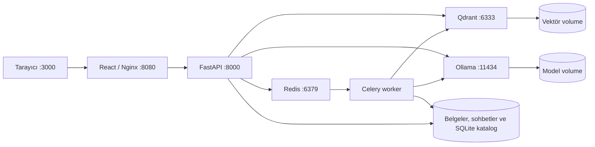

# DocuMind

Yerel, belgelere dayalı yanıt üreten belge asistanı. **React + FastAPI + Qdrant + Ollama + Redis + Celery worker**; altı servis, tek Docker Compose projesi.

## Belge kuyruğu ve sohbet geçmişi

Yüklemeler `202 Accepted` döndürür; dosya hemen saklanır ve belge kimliği Redis kuyruğuna gönderilir. Ayrı Celery worker PDF çıkarımı, chunking ve embedding işlemlerini yapar. Arayüz `queued → processing → ready` durumlarını ve ilerlemeyi takip eder. Geçici servis hataları en fazla üç kez otomatik yeniden denenir; geçersiz dosyalar `failed` olur. Başarısız işlerde dosya korunur ve “Yeniden dene” kullanılabilir. İşlenmekte olan belgeler sorguya alınmaz ve işlem bitene kadar silinemez.

Redis AOF ve `redis_data` volume kuyruk verisini saklar. Celery geç onay ve worker kaybında yeniden teslim kullanır; UUID tabanlı sabit vektör kimlikleri aynı işin yeniden tesliminde tekrar vektör üretimini önler. Worker başlangıcında katalogdaki queued/processing/retrying kayıtları yeniden gönderilir. Bu MVP tek worker ve concurrency=1 ile çalıştırılmalıdır; birden fazla worker için dağıtık kilit ve daha güçlü outbox gerekir. API kaydı ile broker gönderimi tek atomik işlem değildir; Redis gönderimi başarısızsa kullanıcıya yeniden deneme durumu gösterilir.

“Yeni sohbet” SQLite'ta ayrı konuşma oluşturur. Başarılı soru/yanıt çiftleri aynı işlemde kalıcı saklanır; önceki sohbetler soldaki listeden açılır. Sayfa yenilemede son seçilen sohbet geri gelir. Sohbetin belge seçimi de saklanır; silinen veya hazır olmayan belgeler seçimden çıkarılır. Sohbet geçmişinin saklanması modelin önceki mesajları bağlam olarak okuduğu anlamına gelmez: her soru hâlâ bağımsız değerlendirilir. Önceki sürümde yalnızca tarayıcı belleğinde kalan ve kapanmış sohbetler geri getirilemez.

```powershell
docker compose logs -f document-worker redis-service
docker compose restart document-worker
```

Geliştirmede worker kaynakları bind-mount edilir; Celery kaynak değişikliğinde worker'ı yeniden başlatın.

## Yanıt kalitesi güncellemesi

Özet yanıtı önce kısa bir bağlamsal paragraf, ardından destekleyici alıntılar içerir. Modelin iki üretim denemesinde doğrulamadan geçen cümleler korunur; yeterli sayıda geçerli cümle varsa bunlardan üç cümlelik bir paragraf birleştirilir. Desteklenmeyen eğitim/uzmanlık ifadeleri veya sayılar içeren cümleler bu tamamlamaya alınmaz. Yeterli geçerli cümle yoksa açık hata döner. Bu kontroller bütün iddiaların anlamsal doğruluğunu garanti etmez. Arayüz, yeni yanıt geldiğinde kısa özetin bulunduğu başlangıca kayar.

PDF'de harf aralığı nedeniyle `P y t h o n` biçiminde çıkan satırlar tespit edilip sözcük sınırları korunarak düzeltilir. Normal metinlere bu işlem uygulanmaz. Genel özet sorularında orijinal dosyanın tamamı kaynak pasajlarına ayrılır; model önemli pasajların numaralarını seçer. İkinci model çağrısı seçilen bilgileri 3–5 cümlelik akıcı Türkçe bir özette birleştirir ve her cümleyi destekleyen pasaj kimliklerini döndürür. Cümlelerin kanıt kimlikleri, eğitim/uzmanlık ifadeleri ve sayıları kaynakla kontrol edilir; hatalı çıktı bir kez yeniden üretilir, tekrar geçmezse 502 döner ve yanlış özet sohbete kaydedilmez. Bu kontrol tam bir anlamsal doğruluk garantisi değildir. Kısa paragrafın altında seçilmiş gerçek belge ifadeleri de gösterilir. Eğitim, beceriler, sertifikalar ve topluluk bölümleri tespit edildiğinde kapsamda tutulur. Toplam 120.000 karakteri aşan seçimlerde kullanıcıdan kapsamı daraltması istenir. Belirli bilgi soruları Qdrant aramasını ve üretken yanıtı kullanmaya devam eder.

Arayüzde getirilen kaynak kartları gösterilmez; API geriye uyumluluk için `sources` alanını korur. Eski belgelerin arama indeksini yenilemek için aktif yükleme/silme işlemi yokken `docker compose exec -T api-backend python -m app.reindex BELGE_UUID` çalıştırılabilir. Orijinal belge ve belge kimliği korunur. Bu yönetim komutu API ile süreçler arası kilit paylaşmaz; bakım sırasında çalıştırılmalıdır.

## Başlatma

Docker Engine / Docker Desktop (Linux containers ve Compose v2) gerekir. CPU için Docker'a yaklaşık 12 GB RAM ayırmak iyi bir başlangıçtır; model ve belge boyutuna göre ihtiyaç değişir. İlk kurulum imaj ve model indirmek için internet kullanır. Belgeler bulut API'lerine gönderilmez.

```powershell
Copy-Item .env.example .env
docker compose up -d --build
docker compose exec llm-service ollama pull qwen2.5:3b
docker compose exec llm-service ollama pull nomic-embed-text
docker compose ps
```

Linux/macOS üzerinde ilk komut yerine `cp .env.example .env` kullanın.

Arayüz: **http://localhost:3000** · API belgeleri: **http://localhost:3000/api/docs**. Swagger arayüzü CDN varlıkları için internet gerektirebilir; uygulamanın kendisi harici varlık kullanmaz.

`samples/docker-notes.md` dosyasını yükleyin ve “Belgeler hangi volume içinde saklanıyor?” diye sorun. İlk yükleme ve ilk yanıt modelin belleğe alınması nedeniyle yavaş olabilir. Başarılı model indirmelerinden sonra durum göstergesi en geç 15 saniyede güncellenir.

## NVIDIA GPU

Host üzerinde uygun NVIDIA sürücüsü ve Docker GPU desteği gerekir (Linux'ta NVIDIA Container Toolkit, Windows'ta Docker Desktop WSL2 GPU desteği).

```powershell
docker compose -f compose.yaml -f compose.gpu.yaml up -d --build
```

GPU ayarı yalnızca Ollama servisine uygulanır. CPU/RAM limitleri ana Compose dosyasındadır; donanımınıza göre düzenleyin.

## Mimari



- Nginx aynı origin üzerinden `/api` isteklerini backend'e yönlendirir. Yalnızca web portu, yalnızca localhost üzerinde yayınlanır.
- Backend ve Qdrant `internal` ağdadır. Web ayrıca host portunun yayınlandığı `edge` ağına bağlıdır. Ollama model indirmek için ayrıca dış erişimli ağa bağlıdır; host portu yayınlanmaz.
- Backend multi-stage wheel build ve root olmayan kullanıcı kullanır. Frontend Node build aşamasından Nginx runtime'a yalnızca statik çıktıyı taşır. İmaj boyutu ölçülmeden belirli bir boyut iddia edilmez.
- Ollama süreç healthcheck'i, API'nin Qdrant + Ollama + model bulunurluğu hazırlık kontrolünden ayrıdır. Qdrant readiness kontrolünü API yapar; Qdrant imajında shell HTTP istemcisi varsayılmaz.
- Model dosyalarının varlığı belleğe yüklenmiş oldukları anlamına gelmez. `/api/health/ready` model varlığını doğrular; ilk çıkarım modelleri yükler. API hazır değilse yükleme ve sohbet 503 döndürür; arayüz kurulum durumunu gösterebilmek için açık kalır.
- PDF sayfa numaraları korunur. MD/TXT için sayfa 1 kullanılır. 1000 karakterlik parçalar 150 karakter örtüşür; embedding 16 parçalık gruplarla üretilir.
- Model adına göre ayrı Qdrant koleksiyonu kullanılır. `EMBED_MODEL` değiştirildiğinde belgeleri yeniden yükleyin; önceki modele ait veriler volume'da korunur.
- Sorgular katalogdaki hazır/seçili belgelerle filtrelenir. Başarısız indekslemede yazılmış vektörler temizlenmeye çalışılır. Katalog yükleme anında kuyruğa alınma durumuyla yazılır; iş başarıyla bitince hazır olarak işaretlenir.

## API

| Uç nokta | İşlev |
| --- | --- |
| `GET /api/health/live` | API süreci çalışıyor mu? |
| `GET /api/health/ready` | Veritabanı, Ollama ve modeller hazır mı? |
| `GET /api/documents` | Etkin embedding modelinin belgeleri |
| `POST /api/documents` | Multipart `file`: PDF, MD, TXT; 202 ve belge kimliği |
| `GET /api/documents/{id}` | İş durumu, ilerleme ve hata |
| `POST /api/documents/{id}/retry` | Başarısız belgeyi yeniden kuyruğa al |
| `GET /api/documents/{id}/file` | Orijinal belgeyi indir |
| `DELETE /api/documents/{id}` | Belgeyi ve vektörlerini sil |
| `POST /api/chat` | `{ "question": "...", "document_ids": [] }` |
| `POST /api/conversations` | Yeni kalıcı sohbet |
| `GET /api/conversations` | Sohbet başlıkları ve mesaj sayıları |
| `GET /api/conversations/{id}` | Mesajları ve belge seçimini getir |
| `DELETE /api/conversations/{id}` | Sohbeti ve mesajlarını kalıcı sil |

Boş `document_ids` tüm hazır etkin belgelerde arar. `POST /api/chat` gövdesindeki isteğe bağlı `conversation_id` soru/yanıt çiftini o sohbete kaydeder; arayüz bunu her istekte gönderir. Yanıt `answer` ve sayfa/metin/skor içeren `sources` döndürür. Kaynaklar getirilen bölümlerdir; modelin her birini gerçekten kullandığını veya cevabın doğru olduğunu garanti etmez.

## Geliştirme ve test

```powershell
docker compose -f compose.yaml -f compose.dev.yaml up --build
```

Backend kaynakları `--reload`, frontend kaynakları Vite HMR ile bind-mount üzerinden güncellenir. Geliştirme modunda da aynı http://localhost:3000 adresi kullanılır.

Docker olmadan test/derleme:

```powershell
python -m venv .venv
.\.venv\Scripts\python -m pip install -r backend/requirements.txt
Set-Location backend
..\.venv\Scripts\python -m pytest -q
Set-Location ../frontend
npm ci
npm run build
```

API testleri gerçek Qdrant in-memory istemcisi ve sahte Ollama HTTP yanıtları kullanır; gerçek model kalitesini veya Docker ağını doğrulamaz.

Çalışan Docker yığınında gerçek modellerle smoke testi (proje kökünden):

```powershell
.\.venv\Scripts\python scripts/smoke.py
```

Bu test örnek belgeyi yükler, soru sorar, kaynak filtresini ve orijinal dosyayı kontrol eder; kendi oluşturduğu belgeyi sonunda siler.

### İlk doğrulama — 12 Ekim 2026

- 5 otomatik API testi geçti; bağımlılıktan gelen bir deprecation uyarısı var.
- React üretim derlemesi ve iki uygulama Docker imajı başarıyla oluşturuldu.
- CPU, GPU ve geliştirme Compose yapılandırmaları doğrulandı. GPU donanımında çalıştırma ve geliştirme HMR akışı test edilmedi.
- Gerçek Qwen 2.5 3B + nomic-embed-text ile yükleme → retrieval → yanıt → indirme → silme smoke testi geçti.
- Arayüz Docker üzerinden açıldı; API, Ollama ve web healthcheck'leri sağlıklı.
- Vite 6.4.4 ile npm audit bildirilen açık sayısı: 0. Bu bir kapsamlı güvenlik denetimi değildir.

## İşletim ve kapsam

```powershell
docker compose logs -f api-backend llm-service
docker compose stop
docker compose down
```

`down` volume'ları korur. **`docker compose down -v` belgeleri, sohbetleri, kuyruk verisini, vektörleri ve indirilen modelleri siler.** Yedekleme için dört volume'u birlikte ele alın.

Bu sürüm tek kullanıcılı yerel MVP'dir: kimlik doğrulama, OCR ve streaming yoktur. Her soru bağımsızdır. Belge işlemleri kaynak sınırlı Celery worker'da yapılır. SQLite katalog ve sohbet geçmişi API/worker arasında ortak volume'dadır; WAL ve transaction ile kullanılır. Çoklu worker/replica için PostgreSQL, dağıtık kilit ve outbox gerekir.

Sıradaki geliştirmeler: SSE yanıt akışı; belge bazlı erişim kontrolü; RAG değerlendirme veri seti; salt okunur MCP sunucusu; imaj tarama ve CI entegrasyon testleri.

API referansları: [Ollama embeddings](https://docs.ollama.com/api/embed), [Ollama chat](https://docs.ollama.com/api/chat), [Qdrant quickstart](https://qdrant.tech/documentation/quickstart/).

### Redis/Celery ve sohbet doğrulaması — 14 Ekim 2026

18 test ve frontend üretim derlemesi geçti. Gerçek Redis/Celery üzerinden örnek belge yükleme, işleme, soru-cevap, dosya indirme ve silme test edildi. Worker durdurulurken API yanıt vermeye devam etti; Redis ve worker yeniden başlatıldıktan sonra bekleyen iş tamamlandı. Yeni sohbet oluşturma eski mesajları korudu; API konteyneri yeniden oluşturulduktan sonra geçmiş SQLite'tan tekrar okundu.

Yerel geliştirme ortamında kuyruk kurtarma testi `python scripts/queue_recovery_smoke.py` ile çalıştırılabilir. Bu test document-worker'ı kısa süre durdurur ve Redis'i yeniden başlatır; aktif kullanıcı yüklemesi yokken kullanın.

Kuyruk referansları: [Celery görevleri](https://docs.celeryq.dev/en/stable/userguide/tasks.html), [Celery Redis broker](https://docs.celeryq.dev/en/stable/getting-started/backends-and-brokers/redis.html).
